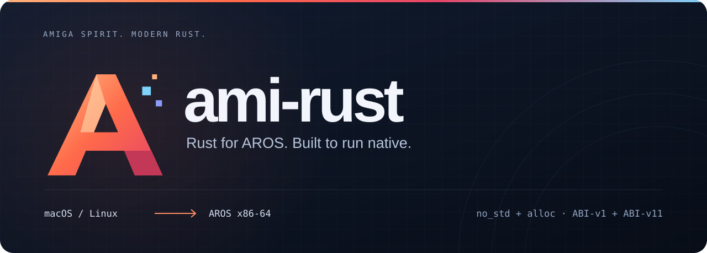

<p align="center">
  
</p>

<p align="center">
  <a href="https://github.com/metaneutrons/ami-rust/actions/workflows/ci.yml"></a>
  
  <a href="LICENSE.md"></a>
  <a href="docs/compatibility.md"></a>
  <a href="docs/api.md"></a>
</p>

<p align="center">
  <strong>Build native AROS applications with standard Rust tools.</strong><br>
  Cross-compile on macOS or Linux. Run on AROS x86-64 ABI-v1 or ABI-v11.
</p>

## What ami-rust provides

ami-rust combines a pinned Rust compiler, Cargo, AROS target libraries, a
relocatable C SDK, native link tools, and AROS/Amiga crates. The public workflow
uses upstream rustup for toolchain selection and ordinary Cargo for builds.
There is no project-specific CLI, Cargo wrapper, or Python dependency.

```text
macOS / Linux host
        │
        ├── rustup selects the versioned ami-rust toolchain
        └── cargo build --target x86_64-aros
                          │
                          └── native AROS executable
```

The initial targets are deliberately narrow: **PC x86-64 AROS ABI-v1 and
ABI-v11** with `no_std` and `alloc`. Full `std`, additional AROS architectures,
and native AROS-hosted rustc/Cargo/rustup are future work.

## Status

ami-rust is preparing its initial 0.1.0 release from the qualified Rust-only
implementation. **0.1.0 has not been published.** There is currently
no supported installation URL, release tag, package-manager channel, or
crates.io publication. Release assets will be published only after the exact
candidate passes the protected three-host and native AROS qualification.

Planned development hosts:

| Host | Architecture |
| --- | --- |
| macOS 26 | Apple Silicon |
| Ubuntu 24.04 | x86-64 |
| Ubuntu 24.04 | ARM64 |

## Standard user workflow

After the first release, users will install the authenticated GitHub Release
toolchain through rustup or the documented direct route. A project then builds
without an ami-rust command:

```sh
cargo +aros build --target x86_64-aros --release --locked --offline
```

The libraries are normal Cargo dependencies. They remain Git-delivered until
their names and public APIs are stable enough for an intentional crates.io
publication. The public base set is:

- `aros` for entry, allocation and the safe core API;
- `aros-sys` for raw AROS ABI declarations;
- `aros-mui` for task-affine MUI ownership;
- `aros-mui-sys` for raw MUI vector calls.

The focused `aros-elf` and `aros-native-build` crates are maintainer and build
support, not application API crates.

See the [API guide](docs/api.md) and the
[SHA-256 example](examples/sha256sum/README.md).

## Build the maintainer tooling

The repository bootstraps its pinned host Rust and Cargo, verifies every input,
and builds the maintainer task offline. The work directory must be fresh and
outside the checkout:

```sh
work="$(mktemp -d)/ami-rust-maintainer"
case "$(uname -s):$(uname -m)" in
  Darwin:arm64|Darwin:aarch64) host=aarch64-apple-darwin ;;
  Linux:x86_64) host=x86_64-unknown-linux-gnu ;;
  Linux:aarch64|Linux:arm64) host=aarch64-unknown-linux-gnu ;;
  *) echo "unsupported development host" >&2; exit 2 ;;
esac
bash tools/build-maintainer-task.sh "$work" "$host"
"$work/target/release/ami-rust-xtask" --help
```

This verifies repository tooling, not a releasable SDK. Candidate production,
signing, AROS execution, and publication remain protected workflow stages.

## Repository map

| Path | Purpose |
| --- | --- |
| `crates/` | Public AROS and Amiga libraries |
| `examples/` | Native AROS example applications |
| `native/` | Startup and runtime support |
| `targets/` | Rust target specification |
| `tooling/` | Rust-only producer and qualification libraries |
| `release/` | Pinned inputs, contracts, notices, and source obligations |
| `host/` | Narrow, versioned upstream portability patches |

## Documentation

- [Compatibility boundary](docs/compatibility.md)
- [API and lifetime contracts](docs/api.md)
- [Source checkout guide](docs/quickstart-toolchain.md)
- [Release and version model](docs/release-versioning.md)
- [Maintainer workflow](docs/maintainers.md)
- [Platform roadmap](docs/platform-roadmap.md)
- [Contributing](CONTRIBUTING.md) and [security policy](SECURITY.md)

## Licence and provenance

First-party code and artwork are licensed under **MIT OR Apache-2.0**. Third-
party components retain their own terms. See [LICENSE.md](LICENSE.md),
[THIRD_PARTY_NOTICES.md](THIRD_PARTY_NOTICES.md), and the corresponding-source
records under `release/`.
