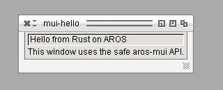

# Crates and consumer guide

ami-rust is a standard Cargo cross-toolchain for the two qualified PC x86-64
AROS targets:

| Target | Select when the guest runs | Native library-base convention |
| --- | --- | --- |
| `x86_64-unknown-aros-abi1` | AROS ABI-v1 | final ordinary call argument |
| `x86_64-unknown-aros-abi11` | AROS ABI-v11 | `r12` |

The target name is the ABI selector. Do not try to select ABI-v1 or ABI-v11
through a Cargo feature, `cfg` override, or a custom linker invocation. A
program and every dependency must use one target for one build.

## Select a crate

| Crate | Use it for | Safe boundary |
| --- | --- | --- |
| `aros` | Application entry, task-local context, Exec-backed allocation, files, streams, libraries, signals, local ports and messages | Default application crate |
| `aros-sys` | A raw AROS declaration or vector call not yet available through `aros` | Unsafe; caller owns every pointer, library base and lifetime |
| `aros-mui` | Typed MUI objects, ownership scopes, attributes, notifications, callbacks, requesters, and the application loop | Preferred MUI crate |
| `aros-mui-sys` | A raw MUI vector, class, tag, or message not safely modelled by `aros-mui` | Unsafe; caller owns the complete native contract |
| `aros-native-build` | The `build.rs` integration that compiles the selected native bridge and verifies its inputs | Build dependency only; applications do not call it |

All five packages are Git-delivered for 0.1.0 and intentionally absent from
crates.io. The following immutable revision is the 0.1.0 source release:

```toml
rev = "8456843ca869a738dde6dc7b7a062a2fdc3b6597"
```

## Start a graphical application

Create the package, then add the following files. This is the standalone form
of [`examples/mui-hello`](../examples/mui-hello/README.md).

`Cargo.toml`:

```toml
[package]
name = "my-aros-window"
version = "0.1.0"
edition = "2024"

[dependencies]
aros = { git = "https://github.com/metaneutrons/ami-rust", rev = "8456843ca869a738dde6dc7b7a062a2fdc3b6597", features = ["alloc"] }
aros-mui = { git = "https://github.com/metaneutrons/ami-rust", rev = "8456843ca869a738dde6dc7b7a062a2fdc3b6597" }

[build-dependencies]
aros-native-build = { git = "https://github.com/metaneutrons/ami-rust", rev = "8456843ca869a738dde6dc7b7a062a2fdc3b6597" }
```

`build.rs`:

```rust
fn main() {
    aros_native_build::prepare(Default::default()).expect("AROS native bridge");
}
```

`src/main.rs`:

```rust
#![no_main]
#![no_std]

use aros::{AppStatus, Context};
use aros_mui::{
    Error, LoopControl, Mui, ReturnId, Trigger,
    attributes::{
        ApplicationBase, ApplicationTitle, Frame, GroupHoriz, TextContents, WindowCloseGadget,
        WindowCloseRequest, WindowOpen, WindowTitle,
    },
    classes::{Application, Group, Text, Window},
    values::FrameValue,
};

fn run(context: &Context) -> Result<(), Error> {
    let mui = Mui::open(context)?;
    let result = mui.scope(|scope| {
        let heading = scope
            .builder::<Text>()
            .with::<TextContents>(c"Hello from Rust on AROS")?
            .with::<Frame>(FrameValue::Text)?
            .build()?;
        let root = scope
            .builder::<Group>()
            .with::<GroupHoriz>(false)?
            .build()?;
        root.adopt(heading)?;
        let window = scope
            .builder::<Window>()
            .with::<WindowTitle>(c"My AROS window")?
            .with::<WindowCloseGadget>(true)?
            .build()?;
        window.adopt(root)?;
        let app = scope
            .builder::<Application>()
            .with::<ApplicationBase>(c"MYAROSWINDOW")?
            .with::<ApplicationTitle>(c"My AROS window")?
            .build()?;
        app.adopt(window)?;
        window
            .notify::<WindowCloseRequest>(Trigger::Value(true))?
            .return_id(app, ReturnId::QUIT)?;
        window.set::<WindowOpen>(true)?;
        app.run(|_| LoopControl::Continue).map(|_| ())
    });
    mui.close()?;
    result
}

fn application(context: &Context) -> AppStatus {
    run(context).map_or(AppStatus::Error, |_| AppStatus::Success)
}

aros::entry!(application, alloc);
```

The application owns native MUI objects only inside `Mui::scope`. Children are
attached with `adopt`; the scope disposes native roots when it returns. Do not
move an object, hook, callback, or custom class handle outside that scope. Use
`aros-mui-sys` only after documenting the raw pointer, tag, vector, and
lifetime contract that prevents a safe wrapper.

## Configure Cargo and build

Place this in the consumer project's `.cargo/config.toml`:

```toml
[target.x86_64-unknown-aros-abi1]
linker = "aros-link"
rustflags = ["-Zunstable-options"]

[target.x86_64-unknown-aros-abi11]
linker = "aros-link"
rustflags = ["-Zunstable-options"]
```

Use the versioned toolchain installed from the authenticated 0.1.0 distribution.
The initial resolution writes the lockfile; commit it. Subsequent builds are
locked and may run offline after a successful fetch:

```sh
toolchain=0.1.0
cargo +"$toolchain" build --target x86_64-unknown-aros-abi1 --release
git add Cargo.lock
cargo +"$toolchain" fetch --locked
cargo +"$toolchain" build --target x86_64-unknown-aros-abi1 --release --locked --offline
cargo +"$toolchain" build --target x86_64-unknown-aros-abi11 --release --locked --offline
```

Do not put the entire ami-rust `bin` directory ahead of rustup proxies and do
not set `RUST_TARGET_PATH`. The installed toolchain supplies the paired target
specification, libraries, C SDK, `aros-link`, and native collector. It remains
a cross-toolchain: rustc and Cargo run on macOS or Linux, while the executable
runs on the selected AROS guest.

## Scope and compatibility

The 0.1.0 release supports `no_std` plus `alloc`, not full `std`. Its native
evidence covers the qualified QEMU profiles for ABI-v1 and ABI-v11. It does not
establish support for a different CPU, physical hardware, arbitrary crates,
threads, networking, or an AROS-hosted Rust compiler. See the
[compatibility boundary](compatibility.md) and [API inventory](api.md) for
the exact limits.

## `mui-hello` qualification

`mui-hello` is built and run natively for both targets as part of this change.
The ABI-v11 capture below is an authentic QEMU framebuffer image, stored as
WebP.



The [qualification record](mui-hello-qualification.md) names the exact source,
toolchain, targets, guest baselines, commands, and file hashes.
